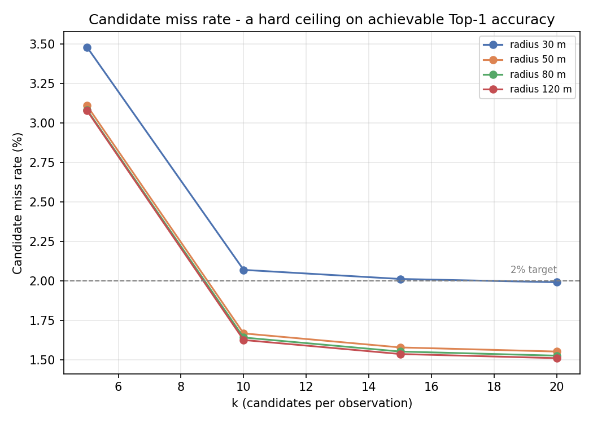
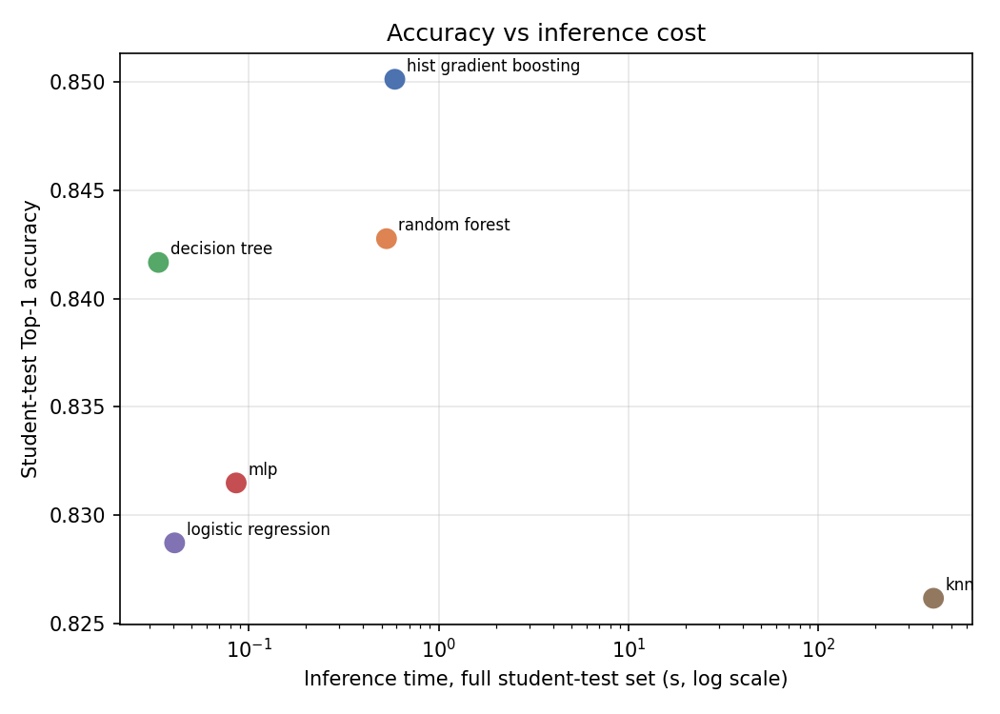

# PathSnap — Technical Report

**UE24CS352A Machine Learning · PES University, RR Campus**

Generated 2026-11-18 from committed experimental results.

Repository: https://github.com/rheasushanth/PathSnap

---

## 1. Problem Statement

>>> WRITE THIS YOURSELF <<< — describe the map-matching problem in your own words: noisy GPS, a road network, and the need to recover which road segment the vehicle was actually on at each observation.

## 2. Dataset Understanding and Exploratory Data Analysis

### 2.1 Dataset inventory

| partition    |   trips |   observations |   median_obs |   total_arcs |   median_sampling_s |   trips_with_gaps_gt_5s |
|:-------------|--------:|---------------:|-------------:|-------------:|--------------------:|------------------------:|
| student_test |      10 |          19160 |         1420 |       185041 |                   1 |                       2 |
| train        |      80 |         208417 |         1529 |      3876904 |                   1 |                      45 |

Geographic extent: longitude -100.4 to 137.2, latitude -34.6 to 61.7 — six continents.

Road-network connectivity: 89 of 90 networks are disconnected, median 19 components, median node degree 2.15.

### 2.2 Anomalous trips

|   trip_id | partition   |   n_obs |   median_snap_m |
|----------:|:------------|--------:|----------------:|
|        33 | train       |    5844 |         122.383 |
|        54 | train       |   19313 |         140.008 |

### 2.3 Label derivation

`.route` is a chronological sequence of arcs, not one label per GPS observation, so per-observation labels were derived by monotonic dynamic-programming alignment.

| partition    |   trips |   labelled_fraction |   median_snap_m | all_monotonic   |
|:-------------|--------:|--------------------:|----------------:|:----------------|
| train        |      80 |              0.9803 |          4.6293 | True            |
| student_test |      10 |              0.9996 |          4.7446 | True            |

### 2.4 Candidate generation and the accuracy ceiling

Candidate miss rate is the fraction of observations whose true arc is absent from the shortlist. It is a hard upper bound on Top-1 accuracy, so it was measured before any model was trained.

|   radius_m |   k |   miss_rate |   mean_candidates_per_obs |
|-----------:|----:|------------:|--------------------------:|
|         30 |   5 |      0.0348 |                    3.6555 |
|         30 |  10 |      0.0207 |                    5.1118 |
|         30 |  15 |      0.0201 |                    5.7024 |
|         30 |  20 |      0.0199 |                    5.9156 |
|         50 |   5 |      0.0311 |                    4.1834 |
|         50 |  10 |      0.0167 |                    6.8331 |
|         50 |  15 |      0.0158 |                    8.5239 |
|         50 |  20 |      0.0155 |                    9.4952 |
|         80 |   5 |      0.0308 |                    4.4662 |
|         80 |  10 |      0.0164 |                    7.9205 |
|         80 |  15 |      0.0155 |                   10.8178 |
|         80 |  20 |      0.0153 |                   13.1887 |
|        120 |   5 |      0.0308 |                    4.6168 |
|        120 |  10 |      0.0162 |                    8.472  |
|        120 |  15 |      0.0154 |                   11.9357 |
|        120 |  20 |      0.0151 |                   15.1015 |

Selected: radius 50 m, k = 10 — miss rate 0.0167, 6.83 candidates per observation, ceiling 0.9833.

**Preprocessing and feature choices.** >>> WRITE THIS YOURSELF <<< — explain the per-trip local projection, the 100 m outlier cutoff, and why each feature group (geometric, directional, kinematic, topological) was included.

---

## 3. Model Experimentation and Comparison

### 3.1 Overall comparison

| model                  | family                 | config                                                              |   cv_macro_f1 |   cv_top1 |   test_top1 |   test_macro_f1 |   test_log_loss |   test_route_continuity |   train_time_s |   inference_time_s |
|:-----------------------|:-----------------------|:--------------------------------------------------------------------|--------------:|----------:|------------:|----------------:|----------------:|------------------------:|---------------:|-------------------:|
| hist_gradient_boosting | Boosting               | max_iter=400, lr=0.05                                               |        0.9034 |    0.8237 |      0.8501 |          0.9144 |          0.1091 |                  0.8444 |        17.9127 |             0.588  |
| random_forest          | Ensemble (bagging)     | 120 trees, min_samples_leaf=20, balanced_subsample                  |        0.8921 |    0.823  |      0.8428 |          0.8991 |          0.1486 |                  0.835  |       159.214  |             0.5316 |
| decision_tree          | Tree-based (single)    | max_depth=14, min_samples_leaf=50, balanced                         |        0.87   |    0.8199 |      0.8417 |          0.8744 |          0.2029 |                  0.8412 |        35.0496 |             0.0335 |
| mlp                    | Neural network         | (64,32), early_stopping, max_iter=60, scaled, fit on 100k subsample |        0.8966 |    0.8163 |      0.8315 |          0.9045 |          0.1222 |                  0.8386 |        63.5871 |             0.0859 |
| logistic_regression    | Linear / probabilistic | C=1.0, class_weight=balanced, scaled                                |        0.8172 |    0.8111 |      0.8287 |          0.8255 |          0.2389 |                  0.8221 |         2.6854 |             0.0407 |
| knn                    | Instance-based         | k=25, weights=distance, scaled, fit on 50k subsample                |        0.8872 |    0.8095 |      0.8262 |          0.8967 |          0.2362 |                  0.8462 |         0.3728 |           403.588  |

### 3.2 Per-model discussion

#### hist_gradient_boosting (Boosting)

- Configuration: `max_iter=400, lr=0.05`

- Student-test Top-1: **0.8501**, Macro F1 0.9144, Log Loss 0.1091

- Cross-validation Top-1: 0.8237 (gap to test +0.0265)

- Why suitable / strengths / limitations: >>> WRITE THIS YOURSELF <<<

- Overfitting or underfitting, with evidence: >>> WRITE THIS YOURSELF <<<

#### random_forest (Ensemble (bagging))

- Configuration: `120 trees, min_samples_leaf=20, balanced_subsample`

- Student-test Top-1: **0.8428**, Macro F1 0.8991, Log Loss 0.1486

- Cross-validation Top-1: 0.8230 (gap to test +0.0197)

- Why suitable / strengths / limitations: >>> WRITE THIS YOURSELF <<<

- Overfitting or underfitting, with evidence: >>> WRITE THIS YOURSELF <<<

#### decision_tree (Tree-based (single))

- Configuration: `max_depth=14, min_samples_leaf=50, balanced`

- Student-test Top-1: **0.8417**, Macro F1 0.8744, Log Loss 0.2029

- Cross-validation Top-1: 0.8199 (gap to test +0.0217)

- Why suitable / strengths / limitations: >>> WRITE THIS YOURSELF <<<

- Overfitting or underfitting, with evidence: >>> WRITE THIS YOURSELF <<<

#### mlp (Neural network)

- Configuration: `(64,32), early_stopping, max_iter=60, scaled, fit on 100k subsample`

- Student-test Top-1: **0.8315**, Macro F1 0.9045, Log Loss 0.1222

- Cross-validation Top-1: 0.8163 (gap to test +0.0152)

- Why suitable / strengths / limitations: >>> WRITE THIS YOURSELF <<<

- Overfitting or underfitting, with evidence: >>> WRITE THIS YOURSELF <<<

#### logistic_regression (Linear / probabilistic)

- Configuration: `C=1.0, class_weight=balanced, scaled`

- Student-test Top-1: **0.8287**, Macro F1 0.8255, Log Loss 0.2389

- Cross-validation Top-1: 0.8111 (gap to test +0.0176)

- Why suitable / strengths / limitations: >>> WRITE THIS YOURSELF <<<

- Overfitting or underfitting, with evidence: >>> WRITE THIS YOURSELF <<<

#### knn (Instance-based)

- Configuration: `k=25, weights=distance, scaled, fit on 50k subsample`

- Student-test Top-1: **0.8262**, Macro F1 0.8967, Log Loss 0.2362

- Cross-validation Top-1: 0.8095 (gap to test +0.0166)

- Why suitable / strengths / limitations: >>> WRITE THIS YOURSELF <<<

- Overfitting or underfitting, with evidence: >>> WRITE THIS YOURSELF <<<

---

## 4. Bayesian Hyperparameter Optimisation

Optuna TPESampler, 25 trials, group-aware cross-validation, objective = observation-level Top-1.

| variant   |   test_top1 |   test_macro_f1 |   test_log_loss |   fit_s |   inference_s |
|:----------|------------:|----------------:|----------------:|--------:|--------------:|
| untuned   |      0.8501 |          0.9144 |          0.1091 |    22.3 |          0.55 |
| tuned     |      0.8495 |          0.9156 |          0.1081 |   170.1 |          2.36 |

Tuned minus untuned Top-1: **-0.0006**.

**Interpretation.** >>> WRITE THIS YOURSELF <<< — the search did not improve Top-1 materially. Discuss why that is a legitimate result: the default configuration was already near-optimal for this feature set, the gain is within fold-to-fold noise, and the tuned model costs substantially more to train for no measurable benefit.

Full trial history: `results/optuna_trials.csv`.

---

## 5. HMM and Viterbi Route Reconstruction

### 5.1 Overall effect (observation-weighted, 10 student-test trips)

| Metric           |   Classifier only |   Classifier + HMM/Viterbi |   Change |
|:-----------------|------------------:|---------------------------:|---------:|
| Top-1 accuracy   |            0.8501 |                     0.8824 |   0.0322 |
| Route continuity |            0.8598 |                     0.9176 |   0.0578 |

Trips improved on Top-1: 10/10. On continuity: 9/10.

### 5.2 Per-trip results

|   trip_id |   n_obs |   clf_top1 |   hmm_top1 |   top1_delta |   clf_continuity |   hmm_continuity |   continuity_delta |   hmm_time_s |
|----------:|--------:|-----------:|-----------:|-------------:|-----------------:|-----------------:|-------------------:|-------------:|
|         0 |    2503 |     0.9149 |     0.9241 |       0.0092 |           0.8196 |           0.9414 |             0.1218 |        1.592 |
|         7 |    1354 |     0.9328 |     0.9948 |       0.062  |           1      |           1      |             0      |        0.732 |
|         9 |    1049 |     0.8637 |     0.8818 |       0.0181 |           0.7885 |           0.8422 |             0.0537 |        1.966 |
|        40 |    2995 |     0.9102 |     0.9279 |       0.0177 |           0.9302 |           0.9628 |             0.0326 |        4.129 |
|        52 |     262 |     0.9427 |     0.9656 |       0.0229 |           0.8372 |           0.8675 |             0.0303 |        0.467 |
|        56 |    3958 |     0.8764 |     0.9165 |       0.0401 |           0.7912 |           0.8754 |             0.0842 |        8.736 |
|        65 |     768 |     0.7904 |     0.8099 |       0.0195 |           0.8397 |           0.867  |             0.0274 |       12.582 |
|        76 |    1486 |     0.8546 |     0.8863 |       0.0316 |           0.7598 |           0.8527 |             0.0929 |        2.667 |
|        77 |    3911 |     0.7106 |     0.7579 |       0.0473 |           0.9429 |           0.96   |             0.0171 |       14.265 |
|        91 |     874 |     0.8375 |     0.8684 |       0.0309 |           0.7353 |           0.8282 |             0.093  |        1.234 |

**Hidden states, emissions, transitions, gap handling.** >>> WRITE THIS YOURSELF <<< — describe each, referring to `src/hmm.py`.

---

## 6. Geographical Visualisation

Interactive Folium map committed at `maps/trip_00000007.html` with four toggleable layers: raw GPS observations, road network, reference route and predicted route.

>>> WRITE THIS YOURSELF <<< — insert a screenshot and describe what it shows.

---

## 7. API, UI and Deployment

FastAPI backend on Laptop 1, Streamlit UI on Laptop 2. The UI lists the evaluation trips, lets the evaluator choose among the trained models and toggle HMM decoding, and renders the predicted route. Ground-truth labels are read server-side only; the response carries aggregate metrics alone.

>>> WRITE THIS YOURSELF <<< — insert screenshots of the working UI and of the API request logs on the receiving laptop.

---

## 8. Academic Integrity and AI-Use Disclosure

>>> WRITE THIS YOURSELF <<< — disclose AI assistance as required by the event policy, and confirm every result reported here is reproducible from the repository.
